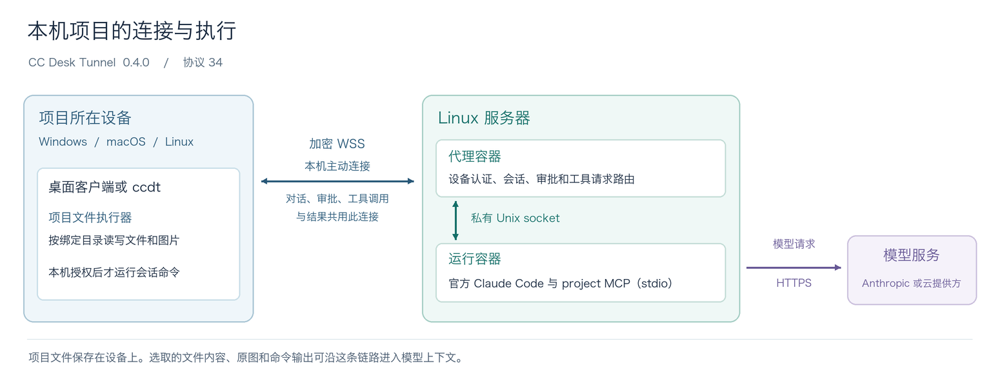

# CC Desk Tunnel（CC 桌面隧道）

**简体中文** | [English](README.en.md)

服务器运行官方 Claude Code，Windows、macOS 或 Linux 客户端通过 WSS 提供本机项目的 MCP 文件工具。测试和构建在项目所在设备执行，需要该会话的本机授权。

**下载**：[图形客户端](#图形客户端) · [终端客户端 ccdt](#终端客户端-ccdt) · [服务端](#1-部署服务端) · [全部版本](https://github.com/lyy0709/cc-desk-tunnel/releases) | [快速开始](#快速开始) · [安全须知](#安全须知) · [文档](#文档) · 许可：[Apache-2.0](LICENSE)

> [!WARNING]
> **本项目主要由 AI 编写**，由个人维护，没有经过专业的安全审计，可能存在尚未发现的缺陷。它会让一台服务器获得在你电脑上执行命令的能力，使用前请读完[安全须知](#安全须知)和[账号须知](#账号须知)，并自行评估风险。
>
> 本项目与 Anthropic 没有隶属或合作关系。“Claude”“Claude Code”是 Anthropic 的商标。

## 解决什么问题

| 常见做法 | 麻烦在哪 | 用 CC Desk Tunnel |
| --- | --- | --- |
| 把项目搬到服务器上，让 Claude Code 在那里开发 | 要在服务器上重装一遍工具链；编译、测试吃配置，得买高配机器；用不了本机的编辑器、模拟器和各种桌面软件 | 项目和工具链留在本机，命令在本机执行；服务器只跑 Claude Code，低配即可 |
| 用远程桌面或 SSH 终端操作服务器上的 CLI | 画面延迟、中文输入和复制粘贴别扭，长输出难以翻阅 | 本机的桌面应用，原生的输入、滚动和复制 |
| 直接使用命令行界面 | 多个项目和会话不好管理，工具调用和思考过程挤在一屏滚动的文字里 | 按项目分组的会话列表，过程折叠成摘要、可逐级展开 |

## 效果示例

图形客户端：按项目分组的会话列表，也能接着另一台电脑上的会话。


终端客户端 `ccdt`：在自己的终端里打开原版 Claude Code，与图形客户端共用会话。


## 工作方式

客户端主动连接代理。模型在服务器上请求项目相对路径，代理把请求送到会话所属设备，本机校验目录与文件版本后返回结果。CC 在独立运行容器内连接模型提供方。界面、审批、项目操作和结果共用已有 WSS 入口。

本仓库公开客户端、服务端以及构建、部署脚本的全部自有源码，不另设闭源功能。**这不意味着 Claude Code 也被本项目开源**：官方 CLI 与 Agent SDK 由官方渠道安装，仍按 Anthropic 的条款使用；随包的第三方组件各自遵循其许可，详见 [NOTICE](NOTICE)。

## 功能

| | |
| --- | --- |
| **项目与会话** | 按 Windows 文件夹分组；新建、改名、删除、搜索、分叉；从任意一条自己的消息“编辑重发” |
| **对话过程** | 流式回复、思考摘要、工具调用的入参与结果；运行中追加消息、随时停止 |
| **原生控制** | 模型、推理强度、审批模式、上下文占用与主动压缩、Claude Code 常用设置；需要时一键在终端客户端 `ccdt` 里打开会话 |
| **终端客户端** | `ccdt` 在自己的终端里打开原版 Claude Code，与图形客户端共用会话、上下文和调用统计 |
| **账号与用量** | 在客户端里登录 / 退出云端的 Claude 账号，图形客户端与 `ccdt` 共用；查看额度、重置时间和调用统计 |
| **定时任务** | 到点向指定会话或新会话发送预设提示词 |
| **省心** | 托盘后台、记住凭据与自动登录、未发送内容按会话保存 |
| **升级** | 服务端跟踪发布页，客户端里提示新版本；服务端在服务器上用一条命令升级，客户端随后在应用内升级 |
| **浏览器访问（可选）** | 与桌面共用工作台，操作在线设备的已有会话，或新建在服务端执行的普通会话；默认关闭，不增加端口或容器 |

## 快速开始

需要：一台有公网 IP 或域名的 Linux 服务器（x86_64；arm64 为实验性支持。推荐 Ubuntu，内核 6.2 或更新，已安装 Docker 和 Compose 2.23.2 或更新），和一台 Windows 10 / 11 x64 电脑。macOS 与 Linux 上也有图形客户端和 `ccdt`，目前都是实验性支持。

**服务器不需要高配。** 编译、测试和各种开发工具都在 Windows 本机运行，服务器上只有 Claude Code 和一个轻量的代理服务，2 核 1 GB 内存的入门机型就能运行。只有打算让 Claude 直接在服务器上编译或跑重负载时，才需要按那些任务选配置。

### 1. 部署服务端

在服务器上执行：

```sh
sudo bash -c "$(curl -fsSL https://raw.githubusercontent.com/lyy0709/cc-desk-tunnel/main/deploy/install.sh)"
```

脚本会：

1. 检查 Docker、Docker Compose 等依赖。缺少时只告诉你安装命令，不会替你安装系统软件。
2. 从本仓库的发布页下载最新的服务端程序包并校验，解压到 `/opt/cc-desk-tunnel`。
3. 询问公网地址、证书方式、端口和数据目录（都有默认值，一路回车即可），然后拉取这个版本的镜像并启动。
4. 打印客户端要填的**服务地址、证书指纹、服务凭据**，以及需要在防火墙放行的 TCP 端口（默认 8787，只有这一个）。

镜像是 GitHub 上预先构建好的（`ghcr.io/lyy0709/cc-desk-tunnel`，x86_64 和 arm64 自动选择），几分钟内就能装好。服务器连不上 ghcr.io 时，脚本会改为在服务器上构建，首次需要多等几分钟。脚本不会修改防火墙、nginx 或 SSH 配置。

装好后，日常管理用 `cc-desk-tunnel` 命令，在任何目录下都能运行：

```sh
sudo cc-desk-tunnel status    # 运行状态
sudo cc-desk-tunnel logs      # 查看日志（Ctrl+C 退出）
sudo cc-desk-tunnel upgrade   # 升级到最新版本；数据、账号和配置保留
sudo cc-desk-tunnel help      # 全部命令：更换凭据、备份恢复、证书等
```

客户端的“设置 → 关于与更新”会提示服务端有新版本；服务端用上面的 `upgrade` 命令升级，之后客户端在同一页升级自己。手动安装、三种证书方式、备份恢复等见[部署操作手册](deploy/README.md)；已有 nginx 和域名时见[用 nginx 反代](deploy/nginx.md)。

### 2. 安装客户端

客户端有两种，可以只装一种，也可以都装；都要与服务端同一版本。

- **图形客户端**：桌面应用，按项目管理会话，对话过程折叠成摘要、可逐级展开。
- **终端客户端 `ccdt`**：在自己的终端里使用原版 Claude Code，与图形客户端共用会话。

#### 图形客户端

从[最新发布页](https://github.com/lyy0709/cc-desk-tunnel/releases/latest)下载，页面开头的表格按系统列出了安装包，点击即下载：

- Windows 10 / 11 x64：`.exe` 安装包。
- macOS（实验性）：Apple 芯片或 Intel 的 `.dmg`，见 [macOS 客户端](docs/macos.md)。
- Linux x64（实验性）：`.deb`，见 [Linux 客户端](docs/linux.md)。

Windows 安装包自带项目文件工具和 PowerShell 7，不需要另装任何东西。启动后填入上一步的三项信息并连接。首次运行会遇到 SmartScreen 提示，处理方法见[杀毒软件与 SmartScreen](#杀毒软件与-smartscreen)。macOS 与 Linux 的客户端没有签名，升级时需要重新下载安装。

#### 终端客户端 ccdt

Windows，在 PowerShell 里运行：

```powershell
irm https://raw.githubusercontent.com/lyy0709/cc-desk-tunnel/main/deploy/install-ccdt.ps1 | iex
```

macOS、Linux（实验性）：

```sh
curl -fsSL https://raw.githubusercontent.com/lyy0709/cc-desk-tunnel/main/deploy/install-ccdt.sh | sh
```

脚本从发布页下载最新的正式版，按 `SHA256SUMS` 校验后只为当前用户安装，并把 `ccdt` 加入 PATH，不需要管理员权限。装好后运行 `ccdt login` 登录服务端。服务端不是最新版时，先指定与它相同的版本，见[终端客户端](docs/cli.md#安装)。

### 3. 登录 Claude 并选择项目

在客户端「设置 → 账号与额度」点“普通登录”，在浏览器打开官方授权页，完成后把页面给出的代码粘贴回来，沿用官方 `claude auth login` 流程；在 `ccdt` 里也可以运行 `ccdt auth login`。图形客户端与 `ccdt` 共用这一个登录和它的订阅额度。要改用 API key 或受支持的云提供方，写进服务器数据目录的 `config/provider.json`。

在桌面选定目录后即可用文件工具工作。“本会话命令权限”允许该会话以当前本机用户身份执行命令；在命令行使用 `ccdt --allow-commands`。换项目、撤销或断线后需要重新授权。

需要浏览器访问时，在桌面「设置 → 浏览器访问」中启用，再用服务凭据登录显示的地址；建议开启验证器两步验证。浏览器不提供本机项目管理或执行通道，使用范围、证书和登录设置见[浏览器访问](docs/server-web.md)。不使用时保留默认关闭即可。

## 安全须知



请在自己控制的服务器部署。桌面使用 WSS 验证 CA 或已核实的证书指纹。本机只需出站连接；服务器默认公开 8787/TCP，nginx 模式可只公开 443。

项目读取结果、用户选择的附件与命令输出会经过服务器发给模型提供方。默认文件工具按本机绑定目录限制访问；开启命令后，项目中的脚本具有当前系统用户权限。服务凭据和备份都应当作秘密保存。

完整的威胁模型、已有的防护和漏洞报告方式见 [SECURITY.md](SECURITY.md)；端口、证书与信任边界的细节见[部署与安全边界](docs/deployment.md)。

## 账号须知

**在 Anthropic 看来，这是什么？** 是一份运行在你服务器上的官方 Claude Code：通过官方 `claude auth login` 流程登录，图形客户端经官方 Agent SDK 启动它，`ccdt` 打开它的原版终端，两者共用同一个登录，直接从服务器连接模型服务。本项目不修改 Claude Code，不经手也不改写它与模型服务之间的请求，不读取或保存登录令牌，不伪造地区、设备或客户端身份。Claude 通过 Claude Code 支持的 MCP 工具读写你电脑上的项目。

这只是对结构的说明，**不是对账号安全的保证**。请留意：

- **服务器出口不能单独证明使用资格。** Claude Code 的模型请求从服务器发出，但 Anthropic 的[地区政策](https://www.anthropic.com/legal/supported-regions)还考虑使用者实际所在地和实体资格；应同时确认这些条件，而不只检查服务器地址。本项目不改变或掩饰地区信息。
- **条款由你自己确认。** Anthropic 对订阅登录和 Agent SDK 的使用范围有明确规定（见其[法律与合规说明](https://code.claude.com/docs/en/legal-and-compliance)），其中限制第三方产品提供 Claude.ai 登录或代为使用订阅额度。技术上能用不代表你的用法获得了许可；拿不准时改用 API key（在数据目录的 `config/provider.json` 中配置）。
- **一个账号只给自己用。** 不要用它共享或转售账号，也不要把服务凭据交给别人使用你的订阅；项目不提供、也不接受这类功能。
- 项目不对账号状态、可用性或合规性作任何承诺。

## 杀毒软件与 SmartScreen

- **不再带 frpc。** 0.2.9 及更早的客户端带有内网穿透工具 frp 的 `frpc.exe`，它经常被 Windows Defender 和其他杀毒软件当作“黑客工具 / 风险软件”隔离。0.2.10 起执行通道由客户端自己经服务地址建立，安装包和服务端镜像里都没有 frp 了；升级后旧的 `frpc.exe` 会被安装程序删除。
- **内置组件被拦截时，先核对再放行。** Windows 客户端随包提供项目文件工具和 PowerShell 7，打包时校验 PowerShell 发行包的 SHA256。遇到时先确认安装包来自本仓库的[发布页](https://github.com/lyy0709/cc-desk-tunnel/releases/latest)，对照 `SHA256SUMS` 校验，并查看具体被拦截的文件。确认来源后，仅对已核验的组件文件设置必要的例外，不建议关闭杀毒软件或排除整个磁盘。文件已被隔离时，可在核验后恢复或重新安装。
- **SmartScreen。** 安装包没有代码签名，首次运行会出现“Windows 已保护你的电脑”，点“更多信息 → 仍要运行”。
- 项目不会修改任何安全软件的设置。不放心可以自己从源码构建。

## 连接失败时

登录页的提示第一行是原因，后面是该检查的地方。连接分两段，可据此判断问题在哪一段：

| 提示 | 含义 | 处理 |
| --- | --- | --- |
| 无法解析域名 / 连接超时 / 拒绝了连接 | 控制连接没有到达服务端 | 核对服务地址与端口，检查服务器是否在线、控制端口是否放行 |
| 证书不受信任 / 指纹不匹配 / 证书已过期 | TLS 校验没有通过 | 自签证书填写安装时给出的 SHA256 指纹；换过证书后用新指纹；过期则在服务器上续期 |
| 服务凭据不正确 | 已连到服务端，凭据被拒绝 | 核对凭据；连续失败多次会被暂时拒绝 |
| 版本不一致 | 客户端与服务端不是同一版本 | 按登录页的提示升级 |
| 项目工具不可用 | 项目设备离线、绑定已失效或运行容器未加载项目 MCP | 查看执行设备和项目 MCP 状态，必要时在本机重新选择目录 |
| 本机命令未授权 | 当前会话没有本机命令权限 | 在项目所在设备确认本会话的命令授权 |

### 用着用着断开时

连接断了不需要做什么：客户端留在原来的界面自己重连，一直试到连上为止，连上之后补上期间的内容。正在进行的任务在服务端继续跑；在途项目操作的结果可能未知。设备重新连接后可以检查文件状态，命令权限需重新授予。

电脑离线超过 5 分钟（服务端的 `PROXY_GRACE_SECONDS` 可改）任务才会停下。此时回到会话，点输入框右下角的“继续”就能接着做，不必再写一句话；手动停止的任务也一样。主动点“断开连接”或退出客户端，任务立即结束。

客户端每 15 秒确认一次服务端还在，约 45 秒没有任何回应就判定连接已断；服务端对客户端也是一样。只有服务端明确拒绝（凭据不对、版本不一致）时才会回到登录页。

要查是哪一段断的，对照两边的记录：

- **客户端**：“设置 → 关于与更新 → 打开日志文件夹”里的 `client.log`，每次连接记着何时建立、何时断开、是窗口还是服务端一侧先断开，以及原因。不含凭据、对话和命令内容。
- **服务端**：`sudo docker logs <容器名> 2>&1 | grep Connection`，每条连接记着是哪台电脑、从哪个地址来、保持了多久、怎样结束的。`no heartbeat answer for 45s` 是服务端等不到客户端的回应；`code 1006` 是对方没有打招呼就断了，多半出在途中的网络、代理或反向代理。

经代理或反向代理连接时，确认它不会掐断长时间没有多少数据的连接；nginx 的写法见[用 nginx 反代](deploy/nginx.md)。

## 使用边界

- **单用户自用。** 一个服务对应一个使用者；这个人可以同时连接自己的几台电脑，每个会话在它的项目目录所在的那台上运行。没有多用户、权限分级或租户隔离，也不打算做。
- **不改官方本体，不做对抗。** 不含任何针对风控或检测的规避设计，也不以突破服务的地区限制为目的。

## 文档

| 文档 | 内容 |
| --- | --- |
| [部署操作手册](deploy/README.md) | 安装、升级、三种 TLS 入口、备份恢复、日常运维 |
| [部署与安全边界](docs/deployment.md) | 端口、证书、凭据、数据与信任边界 |
| [浏览器访问](docs/server-web.md) | 可选 Web 工作台、登录、域名与路径、证书和反向代理 |
| [安全说明](SECURITY.md) | 威胁模型、已有防护、已知不足、漏洞报告 |
| [架构](docs/architecture.md) | 组成、连接建立过程、关键设计决定 |
| [原生运行与会话存储](docs/native-runtime.md) | 如何驱动官方 CLI、上下文归属、审批、保留期 |
| [Windows 客户端](apps/desktop/README.md) · [Linux 服务](apps/server/README.md) · [消息契约](packages/protocol/README.md) | 各模块的实现说明 |
| [macOS 客户端（实验性）](docs/macos.md) · [Linux 客户端（实验性）](docs/linux.md) | 安装、与 Windows 的不同、已验证与未验证 |
| [终端客户端 `ccdt`](docs/cli.md) | 安装、登录、命令、与图形客户端共用会话 |
| [路线与现状](docs/roadmap.md) · [变更记录](CHANGELOG.md) | 已完成、待验证、计划；各版本的变化 |
| [开发约定](docs/development.md) | 分支、提交、检查、发布 |

文档目前只有中文。

## 从源码构建

需要 Git、Node.js 24 与 npm；Windows 上使用 PowerShell 7。

```powershell
npm ci
npm run dev               # 本地模拟服务 + 浏览器界面，不需要任何账号
npm test                  # 单元测试；另有 typecheck、test:ui、check
npm run package:windows   # 生成 Windows 安装包，准备步骤见 apps/desktop/README.md
npm run package:server    # 生成服务端程序包，传到服务器后运行其中的 deploy/install.sh
```

```text
apps/desktop/       Windows 客户端：界面（React）、Electron 主进程、连接桥与本机执行组件
apps/server/        Linux 服务：会话管理、Claude Code 适配、项目 MCP 路由、调用统计、版本跟踪
packages/protocol/  两端消息契约（Zod）
deploy/             Docker 部署与运维脚本
scripts/            工程检查、开发启动、打包、发布
docs/               跨模块的架构、部署、开发文档
```

开发规范见[开发约定](docs/development.md)。

## 社区

认可 [LINUX DO](https://linux.do/) 社区倡导的真诚、友善、团结与专业，也感谢佬友们关于远程开发和开源工具的讨论。欢迎交流使用体验；反馈问题时请先遮盖账号、服务凭据、服务器地址和项目隐私。安全漏洞请走[私下报告入口](SECURITY.md#报告漏洞)。

## Star 趋势

[](https://star-history.com/#sun168567/cc-desk-tunnel&Date)

## 许可

[Apache License 2.0](LICENSE)。随包分发的第三方组件及其许可见 [NOTICE](NOTICE)。
