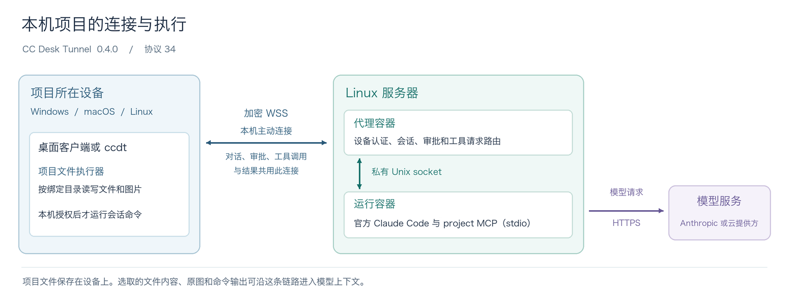

# 架构

## 定位

多端开发时，Claude Code 常部署在云服务器或另一台常开的机器上挂长任务，而项目代码、编辑器和调试工具链在本机。两端之间反复拷贝项目、维护两套环境是主要负担。本项目把 agent 的运行端与项目的执行端分开：Linux 承载原生 Claude Code，Windows、macOS 或 Linux 客户端管理本机项目和执行工具。

边界：

- 个人自用，单个 Linux 服务，多会话；同一使用者的几台项目设备可以同时在线，每个会话属于它的项目目录所在的那台。不做多租户。
- 只在官方 Agent SDK 与未修改的官方 CLI 之上做胶水层。不改 CLI 本体，不复制官方客户端的私有协议，不伪造地区、身份或客户端特征，不含针对检测的对抗设计。
- 升级时管理脚本沿用旧容器的主机名、网卡 MAC 和资源配额，目的是让同一个部署在容器重建前后对 CLI 呈现为同一台机器。这些值取自该部署此前实际运行的容器，不取自别处，也不改写 CLI 读到的任何数据。
- 不把付费订阅转换成共享 API。账号登录只走官方 `claude auth`，凭据由 CLI 自己保存。
- 模型上下文与长期记忆属于云端的 Claude Code；客户端只同步展示，不重组上下文。

## 组成

- 桌面主进程和 `ccdt` 共享设备连接桥、项目绑定以及本机文件执行器。Web 仅接入服务器控制界面。
- Linux 代理管理认证、持久会话和审批。运行容器负责原版 CLI 的标准流与 PTY。
- 工具服务器使用官方 MCP SDK，项目数据通过原有 WSS 入口按请求传输。

## 连接建立

1. 桌面主进程或 `ccdt` 主动连接代理容器，核对 TLS 证书并完成设备认证。同一条 WSS 承载会话、审批、项目请求和结果。
2. GUI 的官方 Agent SDK 通过初始化请求注册 `project`，终端通过官方 CLI 的 `--mcp-config` 注册同一组工具。Claude Code 和 stdio MCP 工具进程都在运行容器中。代理通过每次运行独立的 Unix socket 接收工具调用。
3. 代理将调用送到绑定设备。本机文件工具按项目根目录解析相对路径。命令工具需此连接、此项目和此会话的本机授权。工具结果沿原路返回给 Claude Code，模型请求从运行容器发出。

网络各方能看到的数据见[连接与隐私](../SECURITY.md#连接与隐私)。

## 运行边界

代理负责控制连接与历史索引；运行容器启动 SDK 或终端所需的原版 CLI。详见[原生运行时](native-runtime.md)和[部署与安全边界](deployment.md)。两类入口使用同一 MCP 服务，项目文件可在本机直接开发，工具响应经服务器进入模型上下文。

## 参考

- [Claude Code 程序化使用](https://code.claude.com/docs/en/headless)、[Agent SDK](https://code.claude.com/docs/en/agent-sdk/overview)、[SDK 权限接口](https://platform.claude.com/docs/en/agent-sdk/permissions)
- [Claude Code 法律与合规说明](https://code.claude.com/docs/en/legal-and-compliance)
